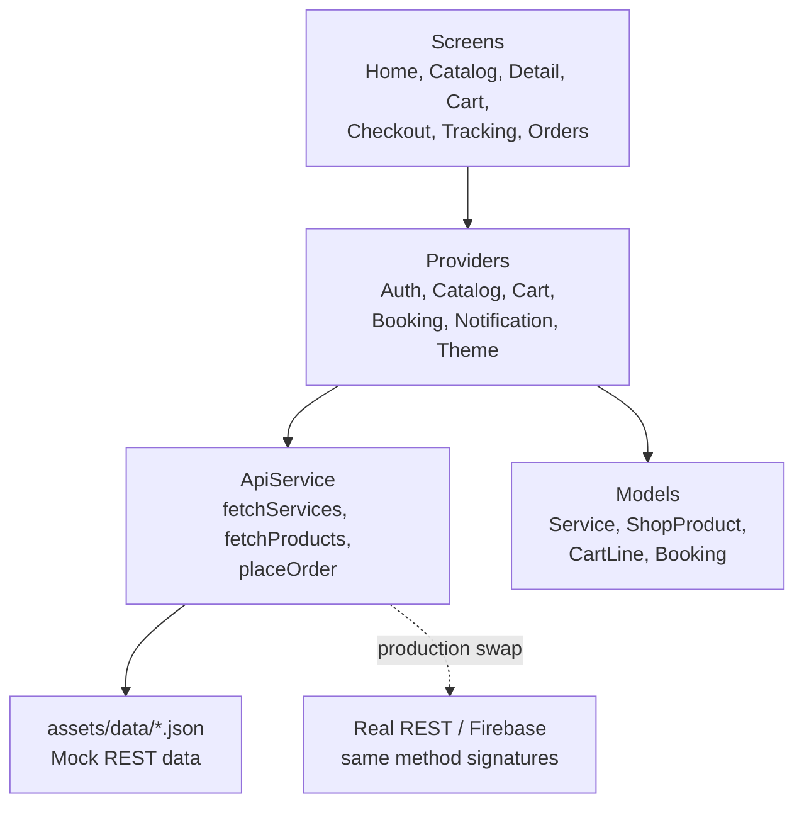

# ServeNow — On-Demand Service Booking & E-Commerce App


**ServeNow** is a production-style Flutter showcase that solves a real business problem: customers want trusted home services *and* the products those services use, in one app, with live tracking and no phone calls. Book a plumber, buy the fitting, watch the technician arrive — in one flow.

Built as a portfolio piece for freelance clients: it looks like a commercial product, runs with zero API keys, and is structured so a real backend can replace the mock layer in one file.

> **Demo in 30 seconds:** run the app → tap **Use demo account** → browse services & shop → add items → checkout (Cash on delivery) → watch the provider move live on the tracking map.

---

## ✨ Features

| Area | What it does |
|---|---|
| **Auth** | Mock login with validation, demo account in one tap, session gating in `main.dart` |
| **Catalog** | 12 services + 12 products, search, category chips, rating/price sort |
| **Service detail** | Hero image, rating, duration, "What's included" checklist, verified provider card |
| **Cart & checkout** | Mixed service + product cart, quantity steppers, free-delivery progress bar, address / city / time-slot / payment (COD, Card, JazzCash/Easypaisa) |
| **Live tracking** | Simulated map (no API key), provider marker moving along the route, timeline, live ETA — all driven by one `progress` value |
| **Bookings** | Order history with status + progress, tap an active booking for tracking |
| **Notifications** | Notification centre with unread badge and mark-all-read — the exact layout FCM payloads will feed |
| **Theme** | Light + dark mode toggle, one design system in `lib/core/theme.dart` |

## 🧭 Screens (demo order for screenshots / video)

1. **Login** — demo account button, validation states
2. **Home** — greeting, search, live-booking banner, popular services, shop grid
3. **Browse** — Services / Shop segmented control, search, category chips, sort
4. **Service Detail** — inclusions, provider, sticky Book bar
5. **Cart** — free-delivery progress, totals breakdown
6. **Checkout** — address, city, slot, payment method
7. **Live Tracking** — map, ETA, timeline (record this one — the marker moves every 3s in demo mode)
8. **Orders / Notifications / Profile** — history, unread badge, dark-mode toggle

## 🏛️ Architecture

Screens never touch data directly. They read **providers**, providers call **`ApiService`**, and `ApiService` reads JSON today / HTTP tomorrow. Swap the backend without touching a single screen.



## 📁 Folder structure

```text
servenow/
├── pubspec.yaml
├── README.md
├── assets/data/
│   ├── services.json        # 12 realistic services (seed data)
│   └── products.json        # 12 realistic products
├── lib/
│   ├── main.dart            # Providers + auth gating + themes
│   ├── core/
│   │   ├── theme.dart       # Design system (colors, light/dark themes)
│   │   ├── constants.dart   # Categories, cities, demo creds, fees
│   │   └── formatters.dart  # PKR + duration formatting (unit-tested)
│   ├── data/
│   │   ├── service.dart / shop_product.dart / cart_line.dart
│   │   ├── booking.dart / app_user.dart / app_notification.dart
│   │   ├── api_service.dart # Mock REST layer (swap for http here)
│   │   └── mock_data.dart   # Seeded bookings + notifications
│   ├── providers/
│   │   ├── auth_provider.dart / catalog_provider.dart
│   │   ├── cart_provider.dart / booking_provider.dart
│   │   ├── notification_provider.dart / theme_provider.dart
│   ├── widgets/
│   │   ├── common_widgets.dart  # AppImage, RatingRow, chips, empty states
│   │   └── cards.dart           # ServiceCard, ProductCard, BookingCard
│   └── screens/
│       ├── auth_screen.dart / main_shell.dart / home_screen.dart
│       ├── catalog_screen.dart / detail_screen.dart
│       ├── cart_screen.dart / checkout_screen.dart
│       ├── tracking_screen.dart / bookings_screen.dart
│       ├── notifications_screen.dart / profile_screen.dart
└── test/
    └── app_test.dart        # Formatter + cart logic tests
```

## 🎨 UI/UX polish guide

**Palette**

| Token | Hex | Use |
|---|---|---|
| Primary teal | `#0E6B62` | Buttons, active states, brand |
| Primary dark | `#0A4F49` | Pressed / depth |
| Accent amber | `#F59E0B` | Prices, ratings, badges, CTAs highlights |
| Ink | `#0F172A` | Headings |
| Slate | `#64748B` | Secondary text |
| Light bg | `#F8FAFC` | Light scaffold |
| Dark bg / card | `#0B1220` / `#111C33` | Dark scaffold / cards |

**Typography:** system Roboto (no download, works offline). Headings 800–900 weight, body regular with 1.5 line height on detail descriptions. Hierarchy comes from size + weight, not extra fonts.

**Layout rules used throughout**

- Cards: 16px radius, image-first, one primary action per card.
- Prices always through `formatPKR()` — never a raw number in a widget.
- Images always through `AppImage` — a failed image host shows a placeholder, never a broken icon in a screenshot.
- One empty state, one loading state, one error + retry pattern — reused, not reinvented per screen.

## 🚀 Installation & run

```bash
# 1. Get dependencies
flutter pub get

# 2. Check for issues (should report: No issues found)
flutter analyze

# 3. Run (any device, emulator, or Chrome for web)
flutter run

# 4. Tests
flutter test
```

**No keys required.** The map is a stylised simulation and the API is local JSON, so the app runs fully offline after `pub get` (images load from picsum; if offline, placeholders appear by design).

**Demo account:** `demo@servenow.app` / `demo1234` — or tap **Use demo account**.

## 💼 Business value — why a client hires from this

- **Booking + commerce in one cart** is what real super-apps sell: one checkout, one delivery, higher average order value than a services-only app.
- **Live tracking** is the feature clients ask for by name and most portfolios fake with a static image. Here it is a working state machine (`BookingProvider.tick()`), so a client can see it move.
- **Mock-to-real API seam** (`ApiService`) de-risks the hire: the client can picture their backend slotting in without a rewrite.
- **Free-delivery progress bar** is a conversion pattern, not decoration — it nudges basket size above the Rs 5,000 threshold.

## 🗺️ Roadmap to production (for a real client)

1. Replace `ApiService` JSON reads with `http` calls to the client's backend (same signatures).
2. Swap `TrackingMap` for Google Maps / `flutter_map` fed by provider GPS coordinates.
3. Replace mock auth with Firebase Auth; store bookings in Firestore.
4. Wire FCM → `NotificationProvider.add()` (model already matches).
5. Add real payment: Stripe / JazzCash / Easypaisa SDK at the checkout payment step.
6. Add provider-side app (accept job, navigate, mark complete) reusing the same `Booking` model.

## 📸 Suggested screenshots (for GitHub / Fiverr / LinkedIn)

Home → Browse (Services) → Service Detail → Cart → Live Tracking (mid-route) → Dark-mode Profile. Capture on a phone frame, light mode first, then one dark-mode shot to prove the theme system.

---

*Built as Portfolio Project 2 of 6 — Flutter, Web, and ML showcases. Next in the series: FinTech Expense Tracker (Flutter) or the SaaS Analytics Dashboard (Web).*
